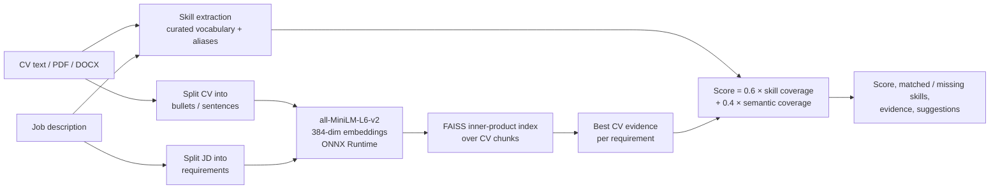

# HireSense AI

[](https://github.com/lonewolf1621/hiresense-ai/actions/workflows/tests.yml) [](https://github.com/lonewolf1621/hiresense-ai/actions/workflows/uptime.yml) [](https://github.com/lonewolf1621/hiresense-ai/actions/workflows/benchmark.yml)

Semantic CV ↔ job matching. Paste or upload a CV and a job description; HireSense scores the fit, lists matched and missing skills, and for every requirement in the job shows the line of your CV that best supports it. Recruiters can also rank up to 10 CVs against one job and download the results.

**Live demo:** [hiresense-ai-vishal.streamlit.app](https://hiresense-ai-vishal.streamlit.app) (open **🧠 Try the CV ↔ Job Matcher**, no login needed) · **API docs:** [hiresense-ai-3k4d.onrender.com/docs](https://hiresense-ai-3k4d.onrender.com/docs)
<sub>Free tier: the first request after a quiet period can take ~1 minute while the API wakes up. A match then takes ~4 seconds.</sub>

---

## How matching works



1. **Skill extraction** from both texts against a curated vocabulary of 75 skills (plus 36 aliases), with aliases (`k8s` → kubernetes, `sklearn` → scikit-learn, "retrieval-augmented generation" → RAG) and guards against ordinary words (`go`, `rest`, `node`) being read as skills.
2. **Requirement filtering:** job-advert boilerplate (company intro, benefits) is skipped; only requirement and duty sentences are scored.
3. **Retrieval:** the CV is split into bullets/sentences and embedded with the `all-MiniLM-L6-v2` Sentence Transformer (384 dimensions), run through ONNX Runtime via `fastembed` so it fits a 512 MB instance without PyTorch. The chunks go into a FAISS inner-product index, and each job requirement retrieves the CV line that supports it best.
4. **Scoring:** `match = 0.6 × skill coverage + 0.4 × semantic coverage`, where semantic coverage is the mean calibrated similarity of the best evidence per requirement. If the model cannot load, the service falls back to lexical similarity and says so in the response (`"method": "lexical"`).

## API

| Method | Path | Auth | Purpose |
|---|---|---|---|
| `POST` | `/api/match` | none | `{resume_text, job_description}` → score, skills, evidence, suggestions |
| `POST` | `/api/match/file` | none | Same, with the CV uploaded as PDF, DOCX or TXT (multipart `file` + `job_description`) |
| `POST` | `/api/match/rank` | none | `{job_description, resumes: [{name, text}]}` → up to 10 CVs ranked best first |
| `POST` | `/api/match/rank/files` | none | Same, with 1–10 uploaded CVs (multipart `files` + `job_description`); unreadable files are listed as skipped |
| `POST` | `/api/auth/register`, `/api/auth/login` | none | JWT access token (bcrypt-hashed passwords) |
| `POST` | `/api/jobs/search` | Bearer | `{keyword, location, source?}` → live jobs with full descriptions and links (Remotive, Arbeitnow, optional Adzuna) |
| `GET/POST/PUT/DELETE` | `/api/applications…` | Bearer | Track jobs you applied to or saved; statuses Saved → Applied → Interview → Offer / Rejected |
| `GET/PUT` | `/api/profile` | Bearer | Profile |
| `POST/GET/DELETE` | `/api/resumes…` | Bearer | CV upload to Cloud Storage, list, delete |
| `POST/GET/PUT` | `/api/applications…` | Bearer | Application tracking |
| `GET` | `/health` | none | Status, Firebase and matcher state |

```bash
curl -X POST https://hiresense-ai-3k4d.onrender.com/api/match \
  -H "Content-Type: application/json" \
  -d '{"resume_text": "Built a RAG system in Python with FAISS and Sentence Transformers; deployed FastAPI services with Docker on GCP.",
       "job_description": "We need Python, NLP and LLM experience. You will deploy services on AWS with Docker and Kubernetes."}'
```

## Evaluation

### Public benchmark: does the score agree with human fit labels?

[`benchmarks/fit_benchmark.py`](benchmarks/fit_benchmark.py) scores the test split of [cnamuangtoun/resume-job-description-fit](https://huggingface.co/datasets/cnamuangtoun/resume-job-description-fit): 1,759 real CV / job-advert pairs labelled *No Fit* (857), *Potential Fit* (444) or *Good Fit* (458). HireSense is not trained on this data; weights are tuned on a train sample only. Runs in GitHub Actions ([`benchmark.yml`](.github/workflows/benchmark.yml)); results in [`benchmarks/results/`](benchmarks/results/).

| Score (test set, n = 1,759) | ROC-AUC fit vs no fit | Spearman vs label |
|---|---|---|
| Overall match score (0.6 skills / 0.4 semantic) | 0.552 | 0.07 |
| Semantic coverage only | **0.563** | 0.06 |
| Skill coverage only | 0.521 | 0.05 |

**Honest reading:** the score agrees with these labels only slightly better than chance (0.5). The labels judge overall fit (seniority, domain, career history) across all industries, while HireSense's skill vocabulary is tech-focused; models fine-tuned on this dataset also score close to the floor according to their own model cards. Two things changed because of the benchmark:

- **Boilerplate filtering:** a [feature experiment](benchmarks/feature_experiment.py) over 11 signals (selected on the train split, reported on test) showed that scoring only requirement and duty sentences beats scoring every line, so the matcher now ignores "About us", benefits and mission text (semantic AUC 0.547 → 0.563).
- **Where the signal is:** whole-document similarity (0.58) and a logistic regression over all signals (0.59) were the strongest; on this mixed-industry data skill coverage adds little. Both are documented for the next iteration rather than shipped, as the gain is small.

**Speed:** 0.22 s per CV/job pair with a cold cache, about **16,700 pairs per hour on one CPU** (GitHub Actions runner); repeated CV and job lines are cached.

### Regression tests

- `python evaluate.py` scores skill extraction on [`data/eval/skill_extraction.json`](data/eval/skill_extraction.json): 40 hand-labelled sentences (90 skill mentions) including traps such as C++/C#, Node.js, "sentence-transformers" vs "transformers", and English uses of *go* and *rest*. All pass; the set was written alongside the extractor, so it is a regression suite that CI enforces (F1 ≥ 0.90), not a benchmark.
- `pytest -q` covers the matcher (scoring, boilerplate filtering, empty inputs) and the API (register → login → profile, wrong passwords, duplicate emails, token checks, `/api/match`, `/api/match/file`, CV ranking).

## Security

- Passwords hashed with bcrypt; JWTs (HS256, 30-minute expiry) signed with `SECRET_KEY` from the environment. Without one, a random per-process key is used, never a hard-coded value.
- Protected routes reject missing or invalid tokens with `401`.
- CORS limited to the Streamlit app (`ALLOWED_ORIGINS`).
- Without Firebase credentials the API runs in demo mode: accounts are kept in memory (cleared on restart) but passwords are still checked.

## Running without anyone's laptop

Everything below runs on GitHub Actions and the hosting platforms, so the demo keeps working without a local machine:

| Workflow | When | What it does |
|---|---|---|
| [`tests`](.github/workflows/tests.yml) | every push, every PR, weekly | pytest + skill-extraction evaluation (F1 ≥ 0.90) |
| [`uptime`](.github/workflows/uptime.yml) | every 6 hours | Smoke-tests the live API (health + a real match) and opens the Streamlit app in headless Chromium, waking it if it is asleep. A failure opens a GitHub issue labelled `uptime`; the next passing run closes it. |
| [`keep-warm`](.github/workflows/keep-warm.yml) | every 10 min, 07:00–20:00 UTC Mon–Fri | Pings `/health` so the API answers without a cold start during UK working hours, within Render's free 750 instance hours a month |
| [`benchmark`](.github/workflows/benchmark.yml) | weekly, and on matcher changes | Re-runs the public fit benchmark and fails if the semantic AUC drops below 0.55 |
| [`workflow-keepalive`](.github/workflows/workflow-keepalive.yml) | twice a month | Re-enables the scheduled workflows so GitHub does not pause them after 60 quiet days |
| [Dependabot](.github/dependabot.yml) | monthly | Dependency and Actions update PRs, each checked by `tests` |

Outside the warm window the free API sleeps after 15 idle minutes and the first request takes about a minute.

## Run locally

```bash
git clone https://github.com/lonewolf1621/hiresense-ai && cd hiresense-ai
python -m venv venv && source venv/bin/activate      # Windows: venv\Scripts\activate
pip install -r requirements.txt
uvicorn app.main:app --reload --port 8000            # API: http://localhost:8000/docs
API_BASE_URL=http://localhost:8000/api streamlit run streamlit_app.py
```

Python 3.11 (pinned in `.python-version`). Optional: Firebase service-account key at `service-account-key.json` (or `FIREBASE_CREDENTIALS_PATH`) for persistent accounts, CV storage and application tracking.

**Deployment:** FastAPI on Render (`pip install -r requirements.txt`, `uvicorn app.main:app`), Streamlit on Streamlit Community Cloud with `API_BASE_URL` set as a secret.

## Project structure

```
app/main.py                  FastAPI app: auth, profile, CVs, applications, /api/match
app/services/matcher.py      Skill extraction, embeddings, FAISS retrieval, scoring
app/services/*               Firestore / Cloud Storage services, parsers, earlier RAG experiments
streamlit_app.py             Streamlit front end (matcher and CV ranking available without login)
scripts/                     Live smoke test and Streamlit wake-up used by the uptime workflow
data/eval/                   Labelled skill-extraction set and latest results
tests/                       pytest suite (matcher + API)
evaluate.py                  Skill-extraction evaluation
benchmarks/                  Public fit benchmark, feature experiment and results
```

## Limitations and roadmap

- **Job search** uses public feeds: Remotive (remote jobs worldwide) and Arbeitnow (Europe) need no key; UK, US, India and other on-site jobs come from Adzuna when `ADZUNA_APP_ID` / `ADZUNA_APP_KEY` are set. Adzuna returns shortened descriptions. The older Indeed/Naukri/Internshala scrapers in `scrapers/` are not used.
- **Dashboard** figures are placeholders until Firebase is connected.
- **Skill vocabulary** is tech-focused (75 skills); non-technical roles rely on the semantic score.
- Planned: a learned fit model on top of the current signals (benchmarked at ROC-AUC 0.59 vs 0.55), and optional LLM re-ranking of the top requirements.

## License

Business Source License 1.1, see [LICENSE.txt](LICENSE.txt): free for non-commercial use; commercial use needs a licence ([COMMERCIAL_LICENSE.md](COMMERCIAL_LICENSE.md)). Converts to Apache 2.0 on 29 June 2030.

---

Author: Vishal Kumar Reddy Gudla · [LinkedIn](https://www.linkedin.com/in/vishalkumar-gudla) · [GitHub](https://github.com/lonewolf1621)
