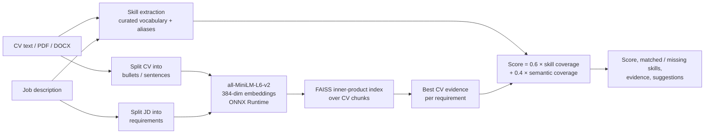

# HireSense AI

Semantic CV ↔ job matching. Paste or upload a CV and a job description; HireSense scores the fit, lists matched and missing skills, and for every requirement in the job shows the line of your CV that best supports it.

**Live demo:** [hiresense-ai-vishal.streamlit.app](https://hiresense-ai-vishal.streamlit.app) (open **🧠 Try the CV ↔ Job Matcher**, no login needed) · **API docs:** [hiresense-ai-3k4d.onrender.com/docs](https://hiresense-ai-3k4d.onrender.com/docs)
<sub>Free tier: the first request after a quiet period can take ~1 minute while the API wakes up. A match then takes ~4 seconds.</sub>

---

## How matching works



1. **Skill extraction** from both texts against a curated vocabulary of 75 skills (plus 36 aliases), with aliases (`k8s` → kubernetes, `sklearn` → scikit-learn, "retrieval-augmented generation" → RAG) and guards against ordinary words (`go`, `rest`, `node`) being read as skills.
2. **Retrieval:** the CV is split into bullets/sentences and embedded with the `all-MiniLM-L6-v2` Sentence Transformer (384 dimensions), run through ONNX Runtime via `fastembed` so it fits a 512 MB instance without PyTorch. The chunks go into a FAISS inner-product index, and each job requirement retrieves the CV line that supports it best.
3. **Scoring:** `match = 0.6 × skill coverage + 0.4 × semantic coverage`, where semantic coverage is the mean calibrated similarity of the best evidence per requirement. If the model cannot load, the service falls back to lexical similarity and says so in the response (`"method": "lexical"`).

## API

| Method | Path | Auth | Purpose |
|---|---|---|---|
| `POST` | `/api/match` | none | `{resume_text, job_description}` → score, skills, evidence, suggestions |
| `POST` | `/api/auth/register`, `/api/auth/login` | none | JWT access token (bcrypt-hashed passwords) |
| `GET/PUT` | `/api/profile` | Bearer | Profile |
| `POST/GET/DELETE` | `/api/resumes…` | Bearer | CV upload to Cloud Storage, list, delete |
| `POST/GET/PUT` | `/api/applications…` | Bearer | Application tracking |
| `GET` | `/health` | none | Status, Firebase and matcher state |

```bash
curl -X POST https://hiresense-ai-3k4d.onrender.com/api/match \
  -H "Content-Type: application/json" \
  -d '{"resume_text": "Built a RAG system in Python with FAISS and Sentence Transformers; deployed FastAPI services with Docker on GCP.",
       "job_description": "We need Python, NLP and LLM experience. You will deploy services on AWS with Docker and Kubernetes."}'
```

## Evaluation

- `python evaluate.py` scores skill extraction on [`data/eval/skill_extraction.json`](data/eval/skill_extraction.json): 40 hand-labelled CV/JD sentences (90 skill mentions) including traps such as C++/C#, Node.js, "sentence-transformers" vs "transformers", and English uses of *go* and *rest*. Current result: precision 1.00, recall 1.00. The set was written alongside the extractor, so treat it as a regression suite that CI enforces (F1 ≥ 0.90), not as a benchmark.
- `pytest -q` covers the matcher (scoring behaviour, empty inputs, a stronger CV scoring higher) and the API (register → login → profile, wrong passwords, duplicate emails, token checks, `/api/match`).

Both run in GitHub Actions on every push.

## Security

- Passwords hashed with bcrypt; JWTs (HS256, 30-minute expiry) signed with `SECRET_KEY` from the environment. Without one, a random per-process key is used, never a hard-coded value.
- Protected routes reject missing or invalid tokens with `401`.
- CORS limited to the Streamlit app (`ALLOWED_ORIGINS`).
- Without Firebase credentials the API runs in demo mode: accounts are kept in memory (cleared on restart) but passwords are still checked.

## Run locally

```bash
git clone https://github.com/lonewolf1621/hiresense-ai && cd hiresense-ai
python -m venv venv && source venv/bin/activate      # Windows: venv\Scripts\activate
pip install -r requirements.txt
uvicorn app.main:app --reload --port 8000            # API: http://localhost:8000/docs
API_BASE_URL=http://localhost:8000/api streamlit run streamlit_app.py
```

Python 3.11 (pinned in `.python-version`). Optional: Firebase service-account key at `service-account-key.json` (or `FIREBASE_CREDENTIALS_PATH`) for persistent accounts, CV storage and application tracking.

**Deployment:** FastAPI on Render (`pip install -r requirements.txt`, `uvicorn app.main:app`), Streamlit on Streamlit Community Cloud with `API_BASE_URL` set as a secret.

## Project structure

```
app/main.py                  FastAPI app: auth, profile, CVs, applications, /api/match
app/services/matcher.py      Skill extraction, embeddings, FAISS retrieval, scoring
app/services/*               Firestore / Cloud Storage services, parsers, earlier RAG experiments
streamlit_app.py             Streamlit front end (matcher page available without login)
data/eval/                   Labelled skill-extraction set and latest results
tests/                       pytest suite (matcher + API)
evaluate.py                  Skill-extraction evaluation
```

## Limitations and roadmap

- **Job search** currently returns sample listings; the Indeed/Naukri/Internshala scrapers in `scrapers/` are not wired in. Next step: UK job APIs (Adzuna, Reed).
- **Dashboard** figures are placeholders until Firebase is connected.
- **Skill vocabulary** is tech-focused (75 skills); non-technical roles rely on the semantic score.
- Planned: LLM re-ranking of the top requirements, a larger labelled evaluation set from real job adverts, and CV upload straight into `/api/match`.

## License

Business Source License 1.1, see [LICENSE.txt](LICENSE.txt): free for non-commercial use; commercial use needs a licence ([COMMERCIAL_LICENSE.md](COMMERCIAL_LICENSE.md)). Converts to Apache 2.0 on 29 June 2030.

---

Author: Vishal Kumar Reddy Gudla · [LinkedIn](https://www.linkedin.com/in/vishalkumar-gudla) · [GitHub](https://github.com/lonewolf1621)
